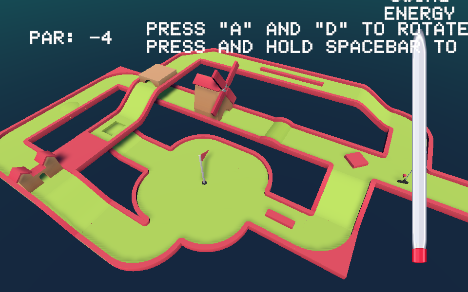

# Mini Golf Game

A physics-driven mini golf game built in Unity. The club is a real physics object: it swings on a hinge joint, strikes the ball, and the ball rolls, bounces and collides according to the physics materials of the ball and the course.

**[▶ Play it in your browser](https://sean030531.github.io/Mini-Golf-game/)**

## How to play

| Key | Action |
|---|---|
| A / D | Rotate the club around the ball to aim |
| Hold Space | Charge the power bar (it rises and falls, so timing matters) |
| Release Space | Swing |

Get the ball into the hole in as few strokes as possible. If the ball leaves the course, it returns to where the shot was taken.

## How the physics works

- **The swing is simulated, not scripted.** The club has a `Rigidbody` and a `HingeJoint`. Releasing Space turns on the hinge motor with a force proportional to the power bar, and the club physically hits the ball. Nothing sets the ball's velocity directly.
- **Tuned physics materials.** The ball (friction 0.2, bounciness 0.6) and the fairway (friction 0.4–0.5, bounciness 0.2) have separate materials, tuned so the ball rolls a believable distance and bounces off walls and obstacles realistically.
- **Shot reset loop.** Once the ball comes to rest, the game re-positions the tee and club at the ball and resets the hinge, so the next shot can be taken from wherever the ball stopped.
- **Moving obstacle.** A windmill with rotating blades sits on the course.

## Design decision worth noting

I first tried swinging the club with `AddTorque`, calculating the torque direction from the club's centre of mass to the ball. No matter how high I set the maximum torque, the swing was too weak to move the ball convincingly. I switched to driving the hinge motor, which gives reliable power at the cost of a slightly less natural swing arc. The original torque-based attempt is kept as comments in `ClubSwingControl.cs`.

## Scripts

| Script | Responsibility |
|---|---|
| `ClubSwingControl.cs` | Power bar charging (oscillates up and down) and hinge-motor swing |
| `GolfGameController.cs` | Stroke counter, detecting when the ball stops, resetting ball, tee and club |
| `RotateAroundGolfBall.cs` | Aiming by orbiting the club around the ball |
| `BallInHole.cs` | Hole trigger and end screen |
| `EnergyBarColorChange.cs` | Power bar changes red → yellow → green as it fills |
| `WindmillRotation.cs` | Windmill obstacle |

## Open in Unity

Unity **2022.3.50f1** (LTS). Open the project folder and load `Assets/Scenes/MiniGolf.unity`.

The skybox comes from the free *Customizable Skybox* package on the Unity Asset Store. Asset Store content cannot be redistributed, so it is not included here: import it from the Asset Store, or the scene will open with a default sky. The playable build in `docs/` already includes it.

## Credits

- Course, ball, club and flag models: [Kenney Minigolf Kit](https://kenney.nl/assets/minigolf-kit) (CC0)
- Power bar sprites and font: [Kenney](https://kenney.nl) (CC0)
- Skybox: *Customizable Skybox* (Unity Asset Store), not included in this repository

## Context

Midterm project for the 3D Graphics and Animation module of my BSc Computer Science (University of London, Goldsmiths).
